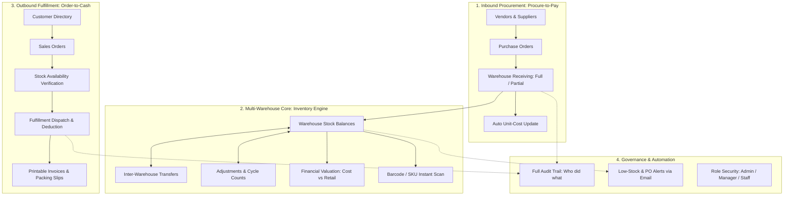
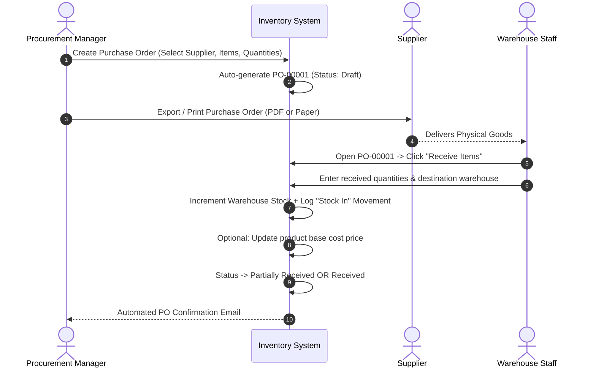
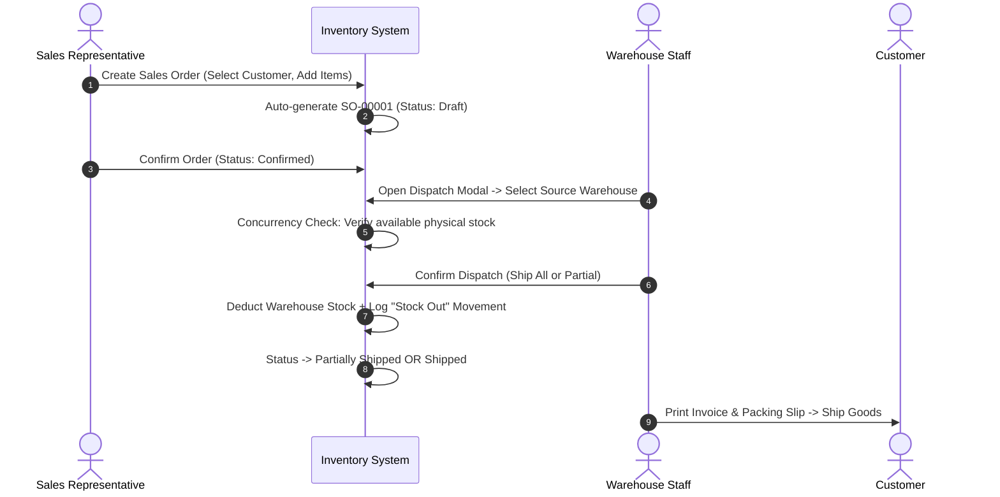
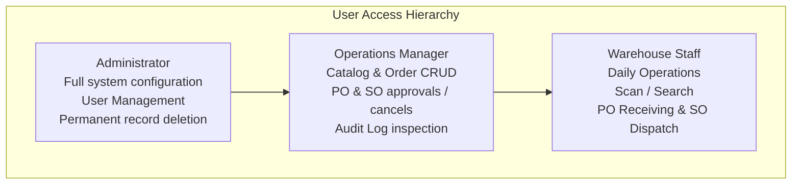

# Inventory Operations Hub — Client Guide & Comprehensive System Manual

**Platform:** Enterprise Inventory Management & Operations System (IMS)  
**Target Audience:** Business Owners, Operations Directors, Warehouse Managers, & Procurement Teams  
**Document Version:** 2.0 (Production Release)  
**Author:** Systems & Solutions Architecture Team  

---

## 1. Executive Summary & The Big Picture

### What is the Inventory Operations Hub?
The **Inventory Operations Hub** is an integrated, full-stack business software platform engineered to control, track, and optimize your entire supply chain lifecycle in real time. It unifies **Procurement (Inbound)**, **Multi-Warehouse Stock Management (Inventory Engine)**, and **Customer Sales & Fulfillment (Outbound)** into a single, intuitive interface.

Rather than managing separate spreadsheets for stock counts, vendor purchasing, customer invoicing, and warehouse locations, this system acts as your **Single Source of Operational Truth**.



---

## 2. Core Master Data: The Bedrock of Your Business

Master data defines the entities your company interacts with daily. Setting this up accurately guarantees error-free operations across all departments.

### 2.1 Products Catalog
* **Automated & Custom SKUs:** The system can automatically generate standardized SKU identifiers (e.g., `PRD-00001`) or accept your existing manufacturer barcodes and model numbers.
* **Barcode Compatibility:** Supports EAN-13, UPC, Code 128, and custom alphanumeric barcodes.
* **Pricing Architecture:**
  * **Cost Price:** What your business pays to acquire or manufacture the unit.
  * **Selling Price:** Default retail or wholesale selling price.
  * **Unit of Measure:** Tracks inventory in pieces (`pcs`), boxes, kilograms, meters, etc.
* **Safety Thresholds (Reorder Level):** Define minimum safety levels per item. When available inventory dips to or below this threshold, automated warnings appear on the dashboard and email alerts are triggered.
* **Smart Soft Deletion & SKU Tombstoning:** If a product is retired or deleted, the system archives it cleanly while "tombstoning" its SKU (e.g., `PRD-00001::deleted::12`). This prevents historical transaction corruption while freeing the original SKU code if you ever need to reuse it.

### 2.2 Hierarchical Product Categories
* Organize your catalog by department, family, or product type (e.g., *Electronics $\to$ Peripherals $\to$ Cables*).
* Categories drive the **Valuation Engine**, showing you exactly how much capital is tied up in each sector of your inventory.

### 2.3 Multi-Warehouse Locations
* Manage distinct physical facilities: Central Distribution Centers, regional fulfillment hubs, retail stores, or transit holding areas.
* Every unit of inventory is strictly tracked by location. You always know not just *how many* you have, but *where* they physically reside.

### 2.4 Supplier Sourcing Directory
* Maintain full vendor records: primary contacts, emails, phone numbers, and physical addresses.
* **Sourcing Terms Matrix:** Connect products to one or more approved suppliers. Specify:
  * Supplier-specific catalog numbers / SKUs
  * Contracted purchase unit costs
  * Vendor lead times (days from order to delivery)
  * Minimum Order Quantities (MOQ)
  * Preferred supplier flags for automated replenishment

### 2.5 Customer Registry
* Store business accounts, individual retail clients, delivery addresses, billing details, and Tax Identification / VAT numbers.
* Live order tracking keeps a historical count of all purchases made by each customer.

---

## 3. Inbound Procurement: How Purchasing Works

The procurement module closes the loop between inventory deficits and vendor replenishment.



### Key Capabilities:
1. **Purchase Order Creation:** Pick a supplier, add multiple line items, set expected delivery dates, and specify negotiated costs.
2. **Partial Receiving:** Real-world logistics rarely delivers 100% of an order in one shipment. If you ordered 100 units and the truck delivers 40, you can receive those 40 immediately into inventory. The system tracks the 60 remaining units and marks the order as `Partial`.
3. **Automatic Cost Averaging / Updating:** When receiving items at a new purchase price, an optional checkbox immediately updates your product catalog's cost price, keeping your profit margin calculations accurate without manual recalculation.
4. **Professional PO Printing:** One-click access to a formatted Purchase Order with vendor details, line totals, and delivery instructions formatted for `@media print` (standard desktop printing or "Save as PDF").

---

## 4. Outbound Fulfillment: How Sales Orders Work

The Sales Order workflow provides a structured fulfillment pipeline, ensuring customer orders are allocated, dispatched, and deducted from warehouse shelves without human counting errors.



### Key Capabilities:
1. **Dynamic Order Builder:** Select customer, enter order dates, shipping destinations, and add products. Unit prices automatically populate from the catalog, with live computation of discounts, taxes, line totals, and grand totals.
2. **Order Lifecycle Stages:**
   * **Draft:** Editable work-in-progress order.
   * **Confirmed:** Formally placed customer order awaiting warehouse fulfillment.
   * **Partially Shipped:** A portion of the line items has left the warehouse.
   * **Shipped:** The order is 100% fulfilled and dispatched.
   * **Cancelled:** Allowed only if no items have been physically shipped.
3. **Pessimistic Concurrency Dispatch:** Before any goods leave the system, the platform validates available stock in the selected source warehouse. If two workers attempt to ship the last remaining units simultaneously, the system uses database row locking to serialize the requests and prevent overselling.
4. **Commercial Invoices & Packing Slips:** Dedicated printable views (`/sales-orders/:id/print`) designed for dispatch documentation, customer billing, and warehouse picking checklists.

---

## 5. Warehouse Inventory Engine: Movements, Adjustments & Transfers

The inventory engine maintains exact stock levels across multiple locations with zero balance drift.

### 5.1 Real-Time Stock Tracking
* Every product's inventory is tracked independently per warehouse.
* **Zero Negative Stock Guarantee:** The system strictly rejects any transaction that would result in negative inventory balances. You cannot ship or adjust out stock you do not have.

### 5.2 Stock Movements (The General Ledger of Inventory)
Every single change to an item's quantity writes an immutable movement log containing:
* Product SKU and Name
* Warehouse location
* User who performed the action
* Movement Type: `in`, `out`, `adjustment`, `transfer_in`, `transfer_out`
* Quantity Delta (`+50`, `-10`)
* Running Balance After Movement
* Transaction Reference / PO Number / SO Number / Note

### 5.3 Inter-Warehouse Transfers
* Need to move 25 units from *Main Distribution Center* to *Retail Store West*?
* The transfer tool executes an **atomic double-entry movement**:
  1. Deducts 25 units from Warehouse A (`transfer_out`).
  2. Adds 25 units to Warehouse B (`transfer_in`).
  3. Links both movements with a shared unique UUID reference.
* If either side fails, the entire transaction rolls back automatically.

### 5.4 Manual Stock Adjustments
* Conduct physical cycle counts, write off damaged goods, or correct discrepancies.
* Supports both positive adjustments (found inventory) and negative adjustments (spoilage, shrinkage).

---

## 6. Executive Operations Dashboard & Financial Intelligence

The dashboard is the central cockpit of your operations, engineered to present actionable information at a glance.

```
+--------------------------------------------------------------------------------------------------------------------+
| Operations Dashboard                   [Live Operations Hub]    Role: Admin/Manager/Staff    [Scan /] [Refresh] [+] |
+--------------------------------------------------------------------------------------------------------------------+
| [ 1. Inventory Valuation ]   [ 2. Stock Volume ]         [ 3. Sales & Fulfillment ]   [ 4. Stock Health & Alerts ] |
| $34,169.00 (at cost)         972 units across 4 WHs      $1,818.35 Total Revenue      2 Items Low                  |
| Retail: $53,240 (+35.8% mgn) 12 SKUs in 6 Categories     3 Pending Dispatch           0 Out of Stock | 1 PO in transit
+--------------------------------------------------------------------------------------------------------------------+
| [Shortcuts Bar]: [Stock Adjust & Transfer] [Sales Orders] [Procure & POs] [Valuation Report] [Customers] [Scan SKU]|
+--------------------------------------------------------------------------------------------------------------------+
| [Action Required: Low Stock & Reorder Alerts]                                                                      |
| - USB-C Triple Display 10-in-1 Docking Station | SKU: PRD-00004 | In Stock: 7 pcs | Reorder: 10 | Deficit: -3 [PO]  |
| - Industrial Bluetooth Thermal Barcode Printer | SKU: PRD-00011 | In Stock: 3 pcs | Reorder: 6  | Deficit: -3 [PO]  |
+-----------------------------------------------------------------+--------------------------------------------------+
| [Warehouse Storage & Valuation Distribution]                    | [Top Categories by Valuation]                    |
| - Main Distribution Center (551 units | 56.7%) [========------] | - Electronics ($20,100 | 20.7%) [======--------] |
| - West Coast Hub          (239 units | 24.6%) [===-----------] | - Packaging   ($6,163  | 41.5%) [==========----] |
| - East Coast Depot        (181 units | 18.6%) [==------------] | - Hardware    ($4,250  | 9.0%)  [==------------] |
+-----------------------------------------------------------------+--------------------------------------------------+
| [Operations Stream: Tabs: (Recent Sales | Recent POs | Movements)| [Live Activity Feed / Audit Trail]               |
| - SO-00004 | Peter Gibbons | $210.44 | [Draft]     [Open ->]    | - Sarah Connor [received] PO-00001 (5m ago)      |
| - SO-00003 | Bruce Wayne   | $385.56 | [Confirmed] [Open ->]    | - Sarah Connor [shipped] SO-00001 (2h ago)       |
| - SO-00002 | Tony Stark    | $676.95 | [Partial]   [Open ->]    | - System [created] SalesOrder SO-00004           |
+-----------------------------------------------------------------+--------------------------------------------------+
| [Quick Barcode & SKU Scanner Modal (Hotkey: /)]: Real-time scanner lookup + direct product inspection modal        |
+--------------------------------------------------------------------------------------------------------------------+
```

### Key Dashboard Components:
1. **Four Primary KPI Vital Signs:**
   * **Inventory Valuation:** Real-time asset value at cost, potential retail value, and profit margin percentage.
   * **Physical Stock Volume:** Total units on hand, active SKUs, and warehouse count.
   * **Sales Order Volume:** Completed order revenue and orders pending dispatch.
   * **Stock Health & Alerts:** Immediate indicator of low-stock and out-of-stock items.
2. **Action-Oriented Low Stock Triage:** Products below safety thresholds are elevated to the top with immediate **+ Create PO** or **Inspect** buttons.
3. **Storage & Valuation Progress Bars:** Visual breakdown of how your inventory is distributed across warehouses and product categories.
4. **Operations Stream:** Tabbed quick view of recent sales orders, purchase orders, and stock movements.
5. **Live Activity Stream:** Real-time audit log of user actions.

---

## 7. Barcode Scanning & Hardware Integration

Designed for high-speed warehouse floors and packing benches:
* **Keyboard-Wedge Scanner Compatible:** Works out of the box with standard USB or Bluetooth barcode laser guns. When a barcode is scanned, it automatically submits.
* **Global Hotkey (`/`):** Pressing the `/` key anywhere in the application instantly triggers the **Quick Barcode / SKU Scanner Modal**.
* **Instant Match & Inspection:** Scanning a code resolves the item within milliseconds, displaying real-time stock levels across all warehouses and providing a one-click button to open the deep product inspector.

---

## 8. Security, RBAC & Governance

The platform implements strict Role-Based Access Control (RBAC) across three operational tiers:



### Permissions Breakdown:
| Feature / Action | Admin | Operations Manager | Warehouse Staff |
| :--- | :---: | :---: | :---: |
| **View Dashboard, Catalog, & Stock** | Yes | Yes | Yes |
| **Perform Stock Adjustments & Transfers** | Yes | Yes | Yes |
| **Receive Purchase Orders & Ship Sales Orders** | Yes | Yes | Yes |
| **Create / Edit Products, Suppliers, Customers** | Yes | Yes | No |
| **Create / Confirm / Cancel POs & Sales Orders** | Yes | Yes | No |
| **View System Audit Logs** | Yes | Yes | No |
| **Manage Users & Role Assignments** | Yes | No | No |
| **Permanently Delete Records (Force Delete)** | Yes | No | No |

### Automatic Audit Logging (`ActivityObserver`)
Every create, update, delete, and restore action across products, categories, suppliers, warehouses, users, purchase orders, and sales orders is permanently captured. The log records:
* Who performed the change
* Exact timestamp and IP address
* Before-and-after diffs of modified attributes

---

## 9. A Day in the Life: Practical Operational Walkthroughs

### Walkthrough 1: Inbound Replenishment
1. Check the **Dashboard** $\to$ note products flagged under *Low Stock Alerts*.
2. Click **+ Create PO** on the flagged item.
3. Select your preferred vendor and submit. The system assigns a sequential number (e.g., `PO-00005`).
4. Click **Print** to send the purchase order to the vendor.
5. When the courier delivers the boxes, warehouse staff open the PO and click **Receive**.
6. Staff enter the count and select the receiving warehouse (e.g., *Main Distribution Center*).
7. Stock levels update immediately, the dashboard clears the low stock alert, and a confirmation email is dispatched.

### Walkthrough 2: Fulfilling a Customer Order
1. A sales rep creates an order under **Sales Orders** $\to$ **New Sales Order**.
2. Select the customer (*Acme Corp*), add line items, apply any agreed discounts, and save.
3. Click **Confirm Order**.
4. The warehouse packing team opens the order and clicks **Ship Items**.
5. The system verifies that the *Main Distribution Center* has sufficient inventory.
6. Staff click **Dispatch All**. Physical stock decreases immediately, and movement logs are recorded.
7. Click **Print** to produce the commercial invoice and packing slip to include inside the shipping box.

---

## 10. Business Value & Return on Investment (ROI)

| Business Problem Solved | How This System Solves It | Financial / Operational Impact |
| :--- | :---: | :---: |
| **Stockouts & Lost Sales** | Automated reorder alerts and procurement workflows | Eliminates missed revenue and emergency vendor surcharges. |
| **Phantom Inventory & Theft** | Strict atomic movements and immutable audit trails | Discrepancies are traced to the exact user, timestamp, and location. |
| **Overselling & Order Cancellations** | Row-locked concurrency checks on sales dispatch | Prevents selling stock that was already claimed by another customer. |
| **Dead Capital in Excess Stock** | Cost vs Retail valuation reports by category | Highlights slow-moving categories so purchasing capital is allocated efficiently. |
| **Fulfillment Delays** | Barcode scan lookups and printable packing slips | Accelerates order picking and reduces packing errors. |

---

*This concludes the official Client Guide & System Manual for the Inventory Operations Hub. For technical API documentation, visit `/docs/api` on your server.*
