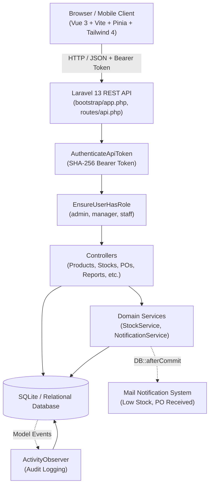
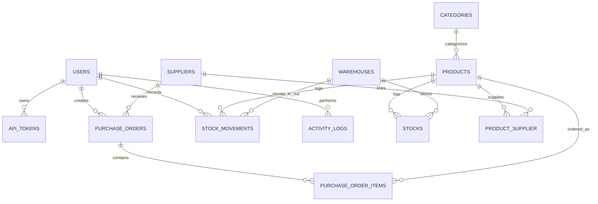
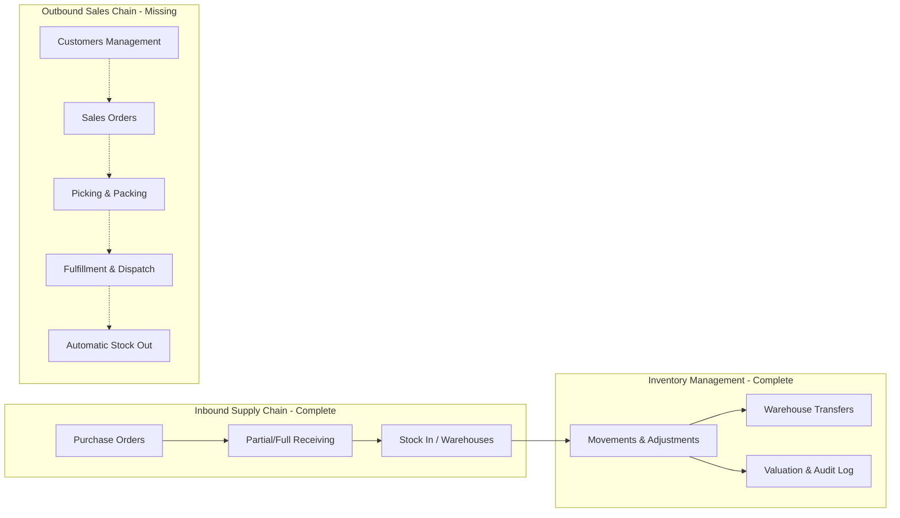

# Inventory Management System — Project Analysis & Strategic Roadmap

## 1. Executive Summary

This project is a modern, full-stack **Inventory Management System (IMS)** built with a **Laravel 13 REST API backend** and a **Vue 3 (Composition API) + Tailwind CSS 4 Single Page Application frontend**.

The application manages multi-warehouse stock levels, catalog data (products, categories, suppliers), purchase order lifecycles with partial receiving, stock transfers, barcode lookups, audit logging, role-based access control (RBAC), and printable order documentation.

### Health & Quality Snapshot
- **Backend Tests:** 86/86 tests passing (310 assertions) across PHPUnit feature suites.
- **Frontend Tests:** 19/19 tests passing across Vitest component and store suites.
- **Code Standards:** 0 ESLint errors, clean Prettier formatting, clean git status on `main`.
- **API Documentation:** OpenAPI 3.1 interactive specification served automatically via Dedoc Scramble (`/docs/api`).

---

## 2. System Architecture & Tech Stack

### High-Level Architecture

### Technology Breakdown

| Layer | Technologies & Libraries | Key Responsibilities |
| :--- | :--- | :--- |
| **Backend Framework** | [Laravel 13.x](backend/) (PHP 8.3+) | Routing, Eloquent ORM, Request validation, JSON Resources |
| **Database** | SQLite (Production ready for MySQL/PostgreSQL) | Relational persistence with foreign keys & cascading constraints |
| **Authentication** | Custom Token Auth (`AuthenticateApiToken`) | SHA-256 hashed bearer tokens with optional expiration & activity tracking |
| **Authorization** | Custom RBAC (`EnsureUserHasRole`) | Granular roles: `admin`, `manager`, `staff` |
| **API Docs** | [Dedoc Scramble](backend/config/scramble.php) | Automatic OpenAPI 3.1 specification and UI at `/docs/api` |
| **Frontend Framework** | [Vue 3](frontend/) (Composition API, `<script setup>`) | Reactive user interface and client-side view management |
| **State & Routing** | Pinia 4, Vue Router 5 | Centralized auth/toast state and guarded role-aware navigation |
| **Styling** | Tailwind CSS 4 (`@tailwindcss/vite`) | Responsive, utility-first layout with print-specific styling |
| **Testing** | PHPUnit 12, Vitest 5, Vue Test Utils | Full backend feature coverage and frontend store/component tests |

---

## 3. Data Model & Entity Relationships

---

## 4. Current Feature Status Audit

| Module | Features Implemented | Backend Endpoints | Frontend Views & Components | Current Status |
| :--- | :--- | :--- | :--- | :--- |
| **Auth & Security** | Token login/logout, current user identity, role check, rate limiting | `POST /login` `POST /logout` `GET /me` | `LoginView.vue` `AppLayout.vue` | **Complete** |
| **User Management** | Admin-only user CRUD, password hashing, role assignment (`admin`, `manager`, `staff`) | `GET/POST/PUT/DELETE /users` | `UsersView.vue` | **Complete** |
| **User Settings** | Opt-in preferences for low stock and PO received emails | `PUT /me/preferences` | `SettingsView.vue` | **Complete** |
| **Categories** | Name, description, product count, soft-delete, restore, force-delete | `GET/POST/PUT/DELETE /categories` `POST /categories/{id}/restore` `DELETE /categories/{id}/force` | `CategoriesView.vue` | **Complete** |
| **Suppliers** | Supplier details, email, phone, address, linked products | `GET/POST/PUT/DELETE /suppliers` `GET /suppliers/{id}/products` | `SuppliersView.vue` | **Complete** |
| **Warehouses** | Multi-warehouse tracking, location, contact, stock isolation | `GET/POST/PUT/DELETE /warehouses` | `WarehousesView.vue` | **Complete** |
| **Products Catalog** | SKU generation, barcode lookup, cost/sell prices, reorder levels, image uploads, soft deletes with SKU tombstoning | `GET/POST/PUT/DELETE /products` `GET /products/lookup` `POST /products/{id}/restore` `DELETE /products/{id}/force` | `ProductsView.vue` `ProductDetailModal.vue` | **Complete** |
| **Supplier Sourcing** | Product-supplier mapping, supplier SKU, unit cost, lead time, MOQ, preferred flag | `GET/POST/PUT/DELETE /products/{id}/suppliers` | Embedded in `ProductsView.vue` modal | **Complete** |
| **Stock Tracking** | Real-time level per warehouse, negative stock prevention, pessimistic locking, audit history | `GET /stocks` `GET /products/{id}/stock` `GET /stock-movements` | `StockView.vue` | **Complete** |
| **Stock Movements** | Stock-in, stock-out, manual adjustments, running balance | `POST /stock-movements` | `StockView.vue` (Adjust modal) | **Complete** |
| **Stock Transfers** | Inter-warehouse transfers, atomic double-entry movement with shared UUID reference | `POST /stock-transfers` | `StockView.vue` (Transfer modal) | **Complete** |
| **Barcode Scanning** | Hardware/keyboard emulation barcode scanning input, instant SKU/barcode lookup | `GET /products/lookup?code=...` | `BarcodeScanInput.vue` (in Products & Stock) | **Complete** |
| **Purchase Orders** | PO creation, status workflow (`draft` -> `partially_received` -> `received` / `cancelled`), line totals, auto PO numbering | `GET/POST/PUT/DELETE /purchase-orders` `POST /purchase-orders/{id}/cancel` | `PurchaseOrdersView.vue` | **Complete** |
| **PO Receiving** | Full or partial receiving per line item, warehouse selection, optional product cost update, email alert | `POST /purchase-orders/{id}/receive` | `PurchaseOrdersView.vue` (Receive modal) | **Complete** |
| **Printable Documents** | Formatted Purchase Order document with `@media print` styling for paper or PDF export | Web route `/purchase-orders/:id/print` | `PrintPurchaseOrderView.vue` | **Complete** |
| **Reports & Valuation** | Dashboard KPI cards, low stock alerts, inventory valuation (cost vs retail vs potential margin) by warehouse & category | `GET /reports/summary` `GET /reports/low-stock` `GET /reports/valuation` | `DashboardView.vue` `ReportsView.vue` | **Complete** |
| **CSV Exports** | Streaming CSV file exports for products and stock movement trails | `GET /exports/products` `GET /exports/stock-movements` | Frontend utility `download.js` | **Complete** |
| **Audit Log** | Automatic tracking of creates, updates (before/after diffs), deletes, restores via Eloquent observer | `GET /activity-logs` | `ActivityView.vue` | **Complete** |

---

## 5. Architectural Strengths & Technical Highlights

1. **Concurrency Safety in Stock Operations:**
   - `StockService.php` executes stock adjustments inside database transactions with `lockForUpdate()`. This eliminates race conditions during rapid or parallel stock modifications.
   - Negative balances are strictly rejected at the domain level with descriptive validation errors.

2. **Smart Soft Deletion & Unique Constraints:**
   - When products or categories with unique fields (like `sku` and `barcode`) are soft deleted, the system applies a tombstone (`sku::deleted::123`), freeing the original SKU/barcode for reuse while preserving historical integrity.
   - Restoring a product validates that no newly active item has claimed the original code before safely stripping the tombstone.

3. **Transaction-Safe Notifications:**
   - `NotificationService.php` uses `DB::afterCommit(...)`. If a transaction rolls back due to a downstream failure, emails are never dispatched.

4. **Role-Based Security on Both Tiers:**
   - Backend routes are protected by role middleware (`role:admin,manager` or `role:admin`).
   - Frontend Vue Router and navigation bars reactively hide views and buttons according to `auth.user.role`.

---

## 6. Gap Analysis: What is Missing for Real-World Deployment?

While the core inventory and inbound procurement loop is solidly built, the following functional gaps exist for standard business operations:

### Key Gaps Identified:
1. **Outbound / Sales Channel (High Priority):**
   - The system tracks stock coming in via Purchase Orders, but stock going out currently relies on manual negative adjustments. There is no customer entity, Sales Order (SO) flow, quotation, packing slip, or invoice generation.
2. **Batch / Lot & Expiration Tracking (Medium Priority):**
   - Products are currently tracked as raw counts. Perishable goods, pharmaceuticals, chemicals, and food require Lot/Batch numbers and expiration dates to enforce FIFO/FEFO (First-In / First-Expired, First-Out).
3. **Warehouse Bin / Location Management (Medium Priority):**
   - Stock is scoped only to a Warehouse, but large warehouses require aisle, rack, shelf, and bin location tracking (`Aisle 3, Rack B, Shelf 2, Bin 14`).
4. **Barcode Label Generation & Camera Scanning (Medium Priority):**
   - While hardware scanners are supported via `BarcodeScanInput`, there is no feature to **print barcode labels** (Code 128 / QR codes) for products or shelves, nor camera-based scanning for mobile devices.
5. **Stocktake & Physical Count Audits (Medium Priority):**
   - Businesses need scheduled cycle counts and blind stock reconciliation tools (recording counted vs recorded stock and auto-generating adjustment entries).
6. **Background Job Queue & Real-time WebSockets (Infrastructure):**
   - Mails are currently sent via PHP mailer during request lifecycle; in high-volume production, this should run on a Redis/database queue.
   - Real-time stock change alerts or live notifications on dashboard.

---

## 7. Strategic Multi-Phase Roadmap

### Phase 1: Outbound Operations & Customer Sales Orders (Immediate Focus)
*Objective: Close the complete supply chain loop (Supplier -> Inventory -> Customer).*

- **1.1 Customer Directory:**
  - Create `customers` table (name, company, email, phone, billing/shipping address, tax ID).
  - API endpoints and Vue management view.
- **1.2 Sales Orders (SO):**
  - Schema: `sales_orders` and `sales_order_items`.
  - Workflow: `draft` -> `confirmed` -> `packed` -> `shipped` -> `delivered` / `cancelled`.
  - Inventory reservation: allocate stock when confirmed; decrement physical stock upon dispatch.
  - Printable Invoices and Packing Slips (`/sales-orders/:id/print`).
- **1.3 Automated Low Stock Alert in Purchase Ordering:**
  - One-click "Generate Draft PO from Low Stock" button that aggregates products below reorder levels by preferred supplier.

### Phase 2: Warehouse Precision & Barcode Label Printing
*Objective: Increase warehouse physical efficiency and error-reduction.*

- **2.1 Barcode Label Generation & Printing:**
  - Printable barcode sheets (Avery label templates / thermal printer sizing) with SKU, product name, barcode, and price.
- **2.2 Mobile Camera Scanning:**
  - Integrate HTML5 camera barcode scanner component (`@zxing/library` or `html5-qrcode`) into `BarcodeScanInput` as a camera toggle for smartphones and tablets.
- **2.3 Sub-Warehouse Bin / Shelf Locations:**
  - Introduce `locations` table linked to warehouses (`warehouse_id`, `aisle`, `rack`, `shelf`, `bin`).
  - Assign primary storage locations to products.

### Phase 3: Stock Auditing, Batches & Returns
*Objective: Compliance, traceability, and returns management.*

- **3.1 Physical Stocktake / Cycle Counts:**
  - Count sheets generation, blind count entry mode, variance reports, and manager approval workflows for auto-adjusting discrepancies.
- **3.2 Lot / Batch & Expiration Date Tracking:**
  - Track batch numbers and expiry dates upon PO receipt.
  - Expiration alerts for expiring goods.
- **3.3 Returns Management:**
  - Supplier Returns (Debit Notes) and Customer Returns (RMA & Credit Notes).

### Phase 4: Production Readiness, Queues & Integrations
*Objective: Enterprise scale, automated communication, and external integrations.*

- **4.1 Asynchronous Queue & Mail Workers:**
  - Configure Laravel queue worker (`database` or `redis`) for emails and heavy CSV exports.
- **4.2 Real-time Updates:**
  - Laravel Reverb / WebSockets for live stock changes across multiple warehouse terminals.
- **4.3 External Integrations:**
  - Webhooks and REST integrations for e-commerce platforms (Shopify, WooCommerce) or accounting software (Xero, QuickBooks).

---

## 8. Immediate Next Steps & Decision Points

To transition smoothly from analysis into execution, we recommend aligning on the next immediate phase:

1. **Scope Selection for Next Sprint:**
   - **Option A (Outbound Sales):** Implement Customers + Sales Orders + Dispatch (recommended to complete the commercial loop).
   - **Option B (Barcode Printing & Mobile Camera):** Implement barcode sticker label generator + mobile camera scanning.
   - **Option C (Warehouse Operations):** Implement physical stock counting / cycle audit module.
2. **Database & Infrastructure Alignment:**
   - Confirm target deployment database (staying on SQLite for local development or configuring PostgreSQL / MySQL).
   - Email provider configuration (Mailpit for local testing, SMTP/SES for staging).
